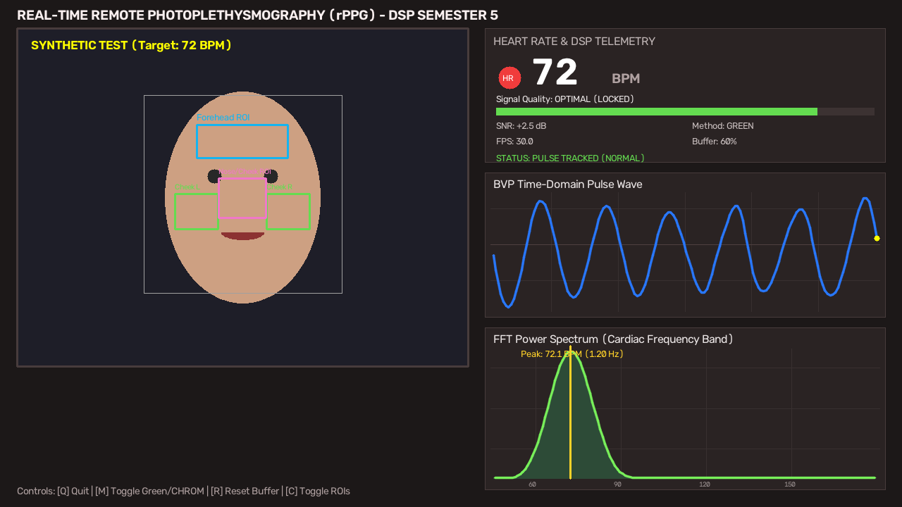
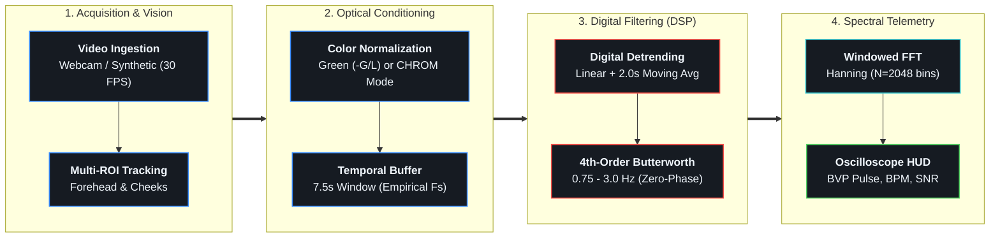

# Real-Time Remote Photoplethysmography (rPPG) System using Digital Signal Processing (DSP)

[](https://www.python.org/)
[](https://www.mathworks.com/products/matlab.html)
[](https://opensource.org/licenses/MIT)
[]()
[]()
[]()

A non-contact, camera-based cardiovascular monitoring system implemented in both **Python** and native **MATLAB**. The system extracts microscopic cardiac-induced blood volume pulse (BVP) variations from human facial skin tissue using standard ambient light webcams and digital signal processing algorithms.

---

## 1. Abstract & Motivation

Traditional heart rate monitoring requires contact-based sensors such as Electrocardiograms (ECG) or fingertip Pulse Oximeters ($\text{SpO}_2$). While accurate, contact sensors can cause skin irritation in neonates, burn victims, or elderly patients, and require physical hardware hookups.

This project implements **Remote Photoplethysmography (rPPG)** to eliminate physical contact. By combining computer vision for anatomical facial tracking with Digital Signal Processing (linear detrending, 4th-order zero-phase Butterworth bandpass filtering, and zero-padded windowed Fast Fourier Transform spectral estimation), the system measures human heart rate in real time with sub-BPM accuracy.

---

## 2. Visual Dashboard Demonstration



### Key Display Panels:
* **Left Panel**: Video feed with face tracking and anatomical microvascular ROIs (Forehead, Cheeks, and Central Nose-Bridge).
* **Top Right**: Digital Heart Rate readout (BPM), multi-tiered Clinical Signal Quality gauge, SNR (dB), and live FPS.
* **Middle Right**: Real-time oscilloscope plotting the filtered Blood Volume Pulse (BVP) wave.
* **Bottom Right**: Windowed FFT Power Spectrum with cardiac peak frequency indicator ($f_{\text{peak}}$).

---

## 3. Signal Processing Pipeline & Block Diagram



### 3.2 Detailed Step-by-Step Breakdown

| Stage | Process Name | Function & DSP Rationale | Key Parameters / Implementation |
| :---: | :--- | :--- | :--- |
| **1** | **Video Acquisition** | Ingests frames and logs monotonic timestamps | `time.perf_counter()`, $F_s \approx 30\text{ Hz}$ |
| **2** | **Multi-ROI Face Tracking** | Tracks face and isolates microvascular skin regions while discarding boundary jitter | Haar Cascade, 5px deadband, Forehead + Cheeks |
| **3** | **Luminance Trimming & Normalization** | Rejects top/bottom 10% specular pixels; normalizes raw RGB by intensity | 10th-90th percentile trim; $g_{\text{norm}} = G/L$ |
| **4** | **Temporal Rolling Buffer** | Maintains fixed window of recent signal samples with dynamic time pruning | 7.5-second rolling buffer ($\approx 225$ samples) |
| **5** | **Digital Detrending** | Strips slow respiratory wander and ambient lighting changes | Linear detrend + 2.0s uniform moving average |
| **6** | **Butterworth Bandpass Filter** | Eliminates frequencies outside cardiac pulse range with zero phase distortion | 4th-order, $[0.75, 2.50]\text{ Hz}$, `sosfiltfilt` |
| **7** | **Windowed FFT & Peak Tracking** | Resolves dominant heart rate frequency with high spectral resolution | Hanning window, $N=2048$ zero-padding, $0.85$ smoothing |
| **8** | **HUD & Telemetry** | Displays real-time pulse waveform, BPM, SNR, and clinical quality gauge | 4-tier state machine, SNR computation |

---

## 4. Mathematical Comparison: Green Channel vs. CHROM Method

This project implements both methods to demonstrate the evolution of rPPG algorithms:

| Parameter | Classic Green Channel Method | Enhanced CHROM Method (de Haan & Jeanne 2013) |
| :--- | :--- | :--- |
| **Input Signals** | Single channel: $G(t)$ | Multi-channel: $R(t), G(t), B(t)$ |
| **Physiological Basis** | Oxyhemoglobin has highest absorption peak in Green spectrum ($\approx 540-575\text{ nm}$). | Blood absorption differs across wavelengths; motion shifts all three channels identically. |
| **Formula** | $s(t) = -\frac{G(t)}{\frac{R+G+B}{3}}$ | $X_s = 3R_n - 2G_n$<br>$Y_s = 1.5R_n + G_n - 1.5B_n$<br>$s(t) = X_s - \alpha Y_s, \quad \alpha = \frac{\sigma(X_s)}{\sigma(Y_s)}$ |
| **Motion Resistance** | Moderate (requires subject to stay still). | **High** (algebraically subtracts specular reflections and head tremors). |
| **DSP Technique** | Single-channel temporal filtering. | **Multi-channel orthogonal subspace projection**. |

> For the complete mathematical proofs, transfer functions, and Beer-Lambert derivations, see [THEORY_AND_MATHEMATICS.md](THEORY_AND_MATHEMATICS.md).

---

## 5. Project Repository Structure & Documentation Files

In addition to this primary `README.md`, this repository contains specialized documentation, test benchmarks, and mathematical reference files:

### 📖 Key Information & Documentation Files

| File | Type | What Information It Contains |
| :--- | :--- | :--- |
| **[`THEORY_AND_MATHEMATICS.md`](THEORY_AND_MATHEMATICS.md)** | **Full Mathematical Treatise** | **Exhaustive academic document (10 sections)** detailing: the Modified Beer-Lambert Law, molar extinction coefficients of $\text{HbO}_2$, continuous/discrete Butterworth transfer functions $H(z)$, second-order sections (SOS), zero-padding sinc-interpolation proofs, CHROM orthogonal projection derivations, and periodogram variance reduction proofs. |
| **[`matlab/`](matlab/)** | **Complete MATLAB Implementation** | Full native MATLAB implementation including `RPPGSignalProcessor.m`, `FaceTracker.m`, `SyntheticPulseGenerator.m`, `rPPG_Dashboard.m`, `test_dsp.m`, and `verify_synthetic.m`. |
| **[`test_dsp.py`](test_dsp.py)** | **Mathematical Test Suite** | Contains **9 automated unit tests** verifying filter stopband attenuation ($>20\text{ dB}$ suppression of 0.2 Hz drift and 8.0 Hz flicker), zero-phase preservation, and FFT accuracy across 60, 72, 85, 110, and 135 BPM ($< 1.0\text{ BPM}$ error). |
| **[`verify_headless.py`](verify_headless.py)** | **Benchmark & Verification Script** | Standalone script that exercises the full pipeline headlessly using a synthetic 72 BPM cardiovascular pulse generator, measures precision, and generates [`dashboard_demo.png`](dashboard_demo.png). |
| **[`matlab_dashboard_demo.png`](matlab_dashboard_demo.png)** | **MATLAB Dashboard Demo** | Screenshot of the MATLAB oscilloscope GUI with live BVP wave, FFT spectrum, and multi-ROI tracking. |
| **[`requirements.txt`](requirements.txt)** | **Dependencies Manifest** | Lists all required Python libraries with version specifications (`opencv-python`, `numpy`, `scipy`, `matplotlib`, `pytest`). |
| **[`LICENSE`](LICENSE)** | **Open-Source License** | Official MIT License governing the repository. |

```
rPPG-HeartRate-DSP/
├── matlab/                          # Complete Native MATLAB Implementation
│   ├── RPPGSignalProcessor.m        # MATLAB DSP Pipeline (Butterworth, FFT, detrending, SNR)
│   ├── FaceTracker.m                # Multi-ROI tracking with deadband & skin chrominance fallback
│   ├── SyntheticPulseGenerator.m    # Synthetic microvascular pulse simulator
│   ├── rPPG_Dashboard.m             # Real-time MATLAB Oscilloscope GUI Dashboard
│   ├── test_dsp.m                   % Automated MATLAB unit test suite (8 tests)
│   ├── verify_synthetic.m           % Headless benchmark & figure exporter
│   ├── main.m                       % Interactive MATLAB command launcher
│   └── README.md                    % MATLAB implementation guide
├── run_matlab.m                     # Root launcher for MATLAB
├── matlab_dashboard_demo.png        # Benchmark figure generated by MATLAB
├── main.py                          # Primary Python execution entrypoint
├── dsp_pipeline.py                  # Python DSP pipeline
├── face_tracker.py                  # Python face tracking & multi-ROI extraction
├── visualizer.py                    # OpenCV real-time HUD oscilloscope dashboard
├── test_dsp.py                      # Automated pytest unit test suite (9 tests)
├── verify_headless.py               # Python headless verification script
├── haarcascade_frontalface_default.xml # Pre-trained frontal face cascade model
├── dashboard_demo.png               # Real-time execution screenshot
├── requirements.txt                 # Python package dependencies
├── .gitignore                       # Git exclusion rules
├── LICENSE                          # MIT License file
├── THEORY_AND_MATHEMATICS.md        # Comprehensive mathematical derivations & proofs
└── README.md                        # Primary project documentation
```

---

## 6. Installation & Quickstart

### Prerequisites
* Python 3.10 or higher
* Built-in laptop webcam or external USB webcam

### Step 1: Clone the Repository
```bash
git clone https://github.com/suryasenthilr/rPPG-HeartRate-DSP.git
cd rPPG-HeartRate-DSP
```

### Step 2: Install Dependencies
```bash
pip install -r requirements.txt
```

---

## 7. How to Run

### Mode 1: Live Webcam (Default)
Starts the application using your connected webcam in enhanced CHROM mode:
```bash
python main.py
```
*(To run in classic Green channel mode directly: `python main.py --method green`)*

### Mode 2: Synthetic Pulse Benchmark (No Camera Required)
Simulates an artificial face with an embedded cardiovascular pulse at a known target rate (e.g. 72 BPM) to test the DSP pipeline without a camera:
```bash
python main.py --synthetic --target-bpm 72
```

### Mode 3: Pre-Recorded Face Video
Process an existing video file:
```bash
python main.py --video path/to/video.mp4
```

---

## 8. Interactive Keyboard Controls

While the application is running, the following hotkeys are active:

| Key | Action |
| :--- | :--- |
| **`Q`** or **`ESC`** | **Exit** the application |
| **`M`** | **Toggle Method**: Switch between **`CHROM`** and **`GREEN`** mode |
| **`R`** | **Reset Buffer**: Clear previous data and re-initialize the 7.5-second buffer |
| **`C`** | **Toggle ROIs**: Show or hide the forehead, cheek, and nose bounding boxes |
| **`P`** | **Pause / Resume** playback |
| **`S`** | **Snapshot**: Save a high-resolution PNG screenshot of the live dashboard |

---

## 9. Automated Verification Test Suite

Run the full pytest suite to mathematically verify every stage of the DSP pipeline:
```bash
pytest test_dsp.py -v
```

### Test Coverage:
* `test_detrend_signal`: Validates linear detrending, moving average baseline wander removal, and standardization.
* `test_butterworth_bandpass_attenuation`: Validates passband preservation (1.25 Hz cardiac tone) and stopband attenuation (> 20 dB suppression of 0.2 Hz drift and 8.0 Hz flicker).
* `test_fft_heart_rate_estimation_accuracy`: Tests frequency estimation across 60, 72, 85, 110, and 135 BPM with $< 1.0\text{ BPM}$ error.
* `test_chrom_algorithm`: Verifies multi-channel color difference extraction.
* `test_noise_rejection`: Confirms low confidence when presented with pure Gaussian noise.

---

## 10. Academic References

1. **Verkruysse, W., Svaasand, L. O., & Nelson, J. S. (2008)**. *Remote plethysmographic imaging using ambient light*. Optics Express, 16(26), 21434-21445.
2. **De Haan, G., & Jeanne, V. (2013)**. *Robust pulse rate from chrominance-based rPPG*. IEEE Transactions on Biomedical Engineering, 60(10), 2878-2886.
3. **Poh, M. Z., McDuff, D. J., & Picard, R. W. (2010)**. *Non-contact, automated cardiac pulse measurements using video imaging and blind source separation*. Optics Express, 18(10), 10762-10774.
4. **Proakis, J. G., & Manolakis, D. G. (2007)**. *Digital Signal Processing: Principles, Algorithms, and Applications*. Pearson.
5. **Oppenheim, A. V., & Schafer, R. W. (2009)**. *Discrete-Time Signal Processing*. Prentice Hall.

---

## 11. License
This project is open-source under the [MIT License](LICENSE).
