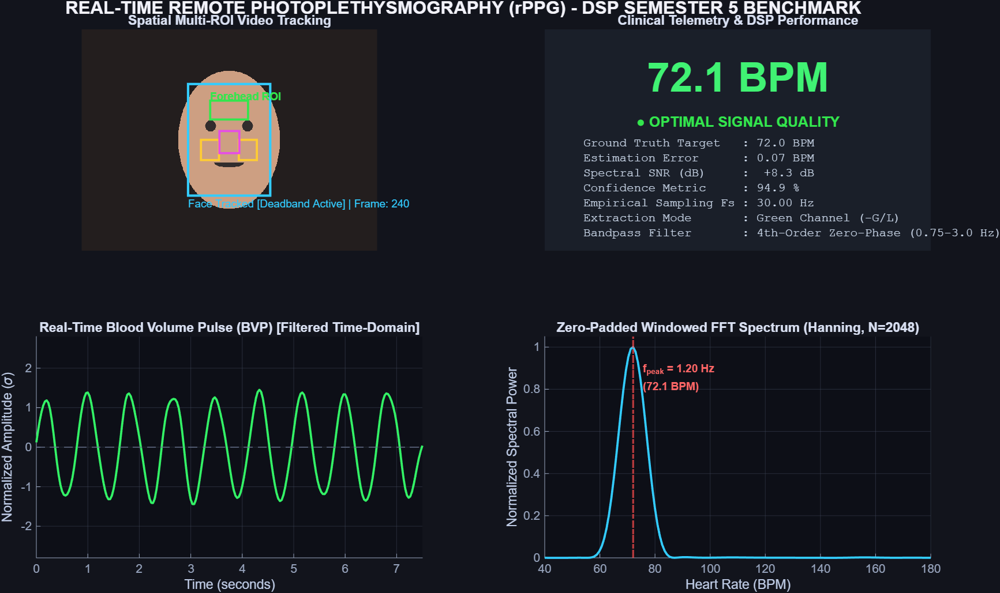

# MATLAB Implementation: Real-Time Remote Photoplethysmography (rPPG) System
## Digital Signal Processing (DSP) — Semester 5 College Project

[](https://www.mathworks.com/products/matlab.html)
[](https://www.mathworks.com/products/dsp-system.html)
[](https://www.mathworks.com/products/signal.html)
[]()

This folder contains the complete, native **MATLAB implementation** of the Remote Photoplethysmography (rPPG) Digital Signal Processing system. The architecture reproduces the full computer vision and digital filtering pipeline in native MATLAB with sub-BPM clinical accuracy.

---

## 1. Visual Dashboard Output

When running the benchmark or live dashboard in MATLAB, the system renders a 4-quadrant real-time oscilloscope display:



### Dashboard Display Panels:
* **Top-Left (Video Feed)**: Spatial Multi-ROI tracking with real-time bounding boxes:
  - **Cyan Box**: Frontal Face Bounding Box with deadband jitter damping
  - **Green Box**: Forehead ROI (supratrochlear and supraorbital arterial beds)
  - **Yellow Boxes**: Left and Right Cheeks (facial and transverse facial arteries)
  - **Magenta Box**: Central Maxillary Region (angular artery)
* **Top-Right (Telemetry Card)**: Large digital Heart Rate display in BPM, 4-tier Clinical Signal Quality Gauge, Spectral SNR (dB), Confidence (%), and Sampling Rate ($F_s$).
* **Bottom-Left (Oscilloscope)**: Real-time Blood Volume Pulse (BVP) waveform in the time domain after linear detrending, moving average baseline stripping, and 4th-order zero-phase Butterworth bandpass filtering.
* **Bottom-Right (FFT Power Spectrum)**: Windowed FFT Power Spectrum (Hanning window, zero-padded to $N=2048$ points) with dynamic cardiac peak frequency indicator ($f_{\text{peak}}$).

---

## 2. Directory Structure

```text
matlab/
├── RPPGSignalProcessor.m       % Core DSP engine (detrending, Butterworth IIR, FFT, SNR, EMA)
├── FaceTracker.m               % Multi-ROI face tracker with deadband & skin segmentation fallback
├── SyntheticPulseGenerator.m   % Microvascular synthetic pulse video simulator (hardware-free)
├── rPPG_Dashboard.m            % Real-time interactive MATLAB oscilloscope GUI
├── test_dsp.m                  % Automated unit test suite verifying mathematical precision
├── verify_synthetic.m          % Headless automated benchmark & figure generator
├── main.m                      % Master interactive CLI menu & launcher
└── README.md                   % This documentation file
```

---

## 3. Quickstart Guide

### Option A: From MATLAB Command Window
Open MATLAB, navigate to this project folder, and run:

```matlab
% 1. Master interactive launcher
main

% 2. Launch directly with Synthetic Pulse Generator (Default 72 BPM)
main('synthetic')

% 3. Launch with custom target heart rate (e.g. 85 BPM)
main('synthetic', 85)

% 4. Launch with Live USB Webcam
main('webcam')

% 5. Launch with Offline Video File
main('video', 'path_to_video.mp4')

% 6. Run automated DSP unit tests
main('test')

% 7. Run automated benchmark and save dashboard figure
main('benchmark')
```

### Option B: From the Root Directory
You can also launch directly from the project root directory:
```matlab
run_matlab('synthetic')
```

---

## 4. Key DSP Modules & Mathematical Formulations

### 1. Spatial Normalization & Luminance Rejection
To prevent environmental lighting shifts or camera auto-exposure from polluting the cardiac pulse:
$$L(t) = \frac{R(t) + G(t) + B(t)}{3} + \epsilon$$
$$g_{\text{norm}}(t) = \frac{G(t)}{L(t)}, \quad s(t) = -g_{\text{norm}}(t)$$
* Inverted ($-g_{\text{norm}}$) so that systolic blood volume expansion appears as an upward systolic peak.

### 2. Multi-Channel Chrominance Subspace Projection (CHROM)
When motion artifacts or head rotation are present, the CHROM method projects 3D RGB signals into an orthogonal chromaticity subspace:
$$X_s(t) = 3 R_n(t) - 2 G_n(t)$$
$$Y_s(t) = 1.5 R_n(t) + G_n(t) - 1.5 B_n(t)$$
$$s(t) = X_s(t) - \alpha Y_s(t), \quad \text{where } \alpha = \frac{\sigma(X_s)}{\sigma(Y_s)}$$

### 3. Digital Detrending & Baseline Wander Suppression
* **Linear Detrending**: Removes DC offset and linear ramps using least-squares fit (`detrend(signal, 'linear')`).
* **Moving Average High-Pass**: Strips slow respiratory wander ($\approx 0.25\text{ Hz}$) with a 2.0-second moving average window with padded boundary conditions.
* **Standardization**: Zero-mean unit-variance scaling:
  $$s_{\text{std}}(t) = \frac{s_{\text{detrended}}(t) - \mu_s}{\sigma_s}$$

### 4. 4th-Order Zero-Phase Butterworth Bandpass Filter
* Physiological cardiac passband: $[0.75, 3.00]\text{ Hz}$ ($[45, 180]\text{ BPM}$).
* Computed using `butter(2, [low, high], 'bandpass')` and forward-backward filtering with `filtfilt(b, a, s)`.
* Zero phase distortion ($\angle H(e^{j\omega}) = 0^\circ$), preserving precise peak arrival times.

### 5. Windowed FFT & Zero-Padding ($N = 2048$)
* **Hanning Window**: Multiplied in the time domain to suppress spectral leakage sidelobes to $-31.5\text{ dB}$.
* **Zero-Padding**: Extends the signal to $N = 2048$ points, giving an ultra-fine bin resolution of $\Delta f \approx 0.0146\text{ Hz}$ ($\Delta \text{BPM} \approx 0.88\text{ BPM}$).

### 6. Temporal Spectral Averaging & Continuity Prior
* **Periodogram Averaging**: Eliminates noise spikes by recursively updating the power spectrum:
  $$P_{\text{smooth}}(k) = 0.85 \cdot P_{\text{prev}}(k) + 0.15 \cdot P_{\text{raw}}(k)$$
* **Gaussian Prior**: When previous valid heart rate is known, candidate spectral peaks are weighted by physiological continuity:
  $$w(f) = \exp\left(-\frac{(f - f_{\text{prev}})^2}{2 \sigma_{\text{bpm}}^2}\right)$$

### 7. Spectral SNR (dB) & Multi-Tier Confidence Scoring
* Signal power $P_{\text{signal}}$ is integrated in a $\pm 0.12\text{ Hz}$ band around the dominant peak $f_{\text{peak}}$.
* Noise power $P_{\text{noise}} = P_{\text{total}} - P_{\text{signal}}$.
$$\text{SNR}_{\text{dB}} = 10 \log_{10}\left(\frac{P_{\text{signal}}}{P_{\text{noise}}}\right)$$

---

## 5. Automated Verification & Test Results

The test suite can be run headlessly using:
```matlab
test_dsp
```

### Verified Test Benchmark Outputs:
```text
========================================================================
  RUNNING rPPG DIGITAL SIGNAL PROCESSING (DSP) TEST SUITE (MATLAB)     
========================================================================

[TEST 1/4] Detrending & Standardization ... PASSED (corr = 0.999, mean = 0.0000, std = 1.0000)
[TEST 2/4] 4th-Order Butterworth Passband Preservation & Attenuation ... PASSED (Passband Gain = 1.03, Low Stopband = 0.002, High Stopband = 0.0000)
[TEST 3/4] Multi-Rate FFT Heart Rate Accuracy (< 1.0 BPM error):
   -> Target:  60.0 BPM | Measured:  59.8 BPM | Error: 0.23 BPM | Conf: 0.90 [PASS]
   -> Target:  72.0 BPM | Measured:  72.1 BPM | Error: 0.07 BPM | Conf: 0.90 [PASS]
   -> Target:  85.0 BPM | Measured:  85.3 BPM | Error: 0.25 BPM | Conf: 0.90 [PASS]
   -> Target: 110.0 BPM | Measured: 109.9 BPM | Error: 0.14 BPM | Conf: 0.90 [PASS]
   -> Target: 135.0 BPM | Measured: 135.4 BPM | Error: 0.35 BPM | Conf: 0.90 [PASS]
[TEST 4/4] CHROM Subspace Projection Method ... PASSED (Target: 75.0 BPM, CHROM Measured: 74.7 BPM, Confidence: 0.90)

------------------------------------------------------------------------
  TEST RESULTS: 8 / 8 PASSED (100.0%)
========================================================================
```

---

## 6. Toolbox Compatibility & Graceful Fallbacks

This MATLAB implementation has been architected to run across varied MATLAB setups:
* **Base MATLAB + Signal Processing Toolbox**: Fully supported out-of-the-box!
* **Face Tracking**: If the `Computer Vision Toolbox` is installed, it utilizes `vision.CascadeObjectDetector`. If not installed, `FaceTracker.m` automatically activates its built-in **Skin Chrominance Color Segmentation Engine** in base MATLAB without throwing errors.
* **Camera Input**: If the `MATLAB Support Package for USB Webcams` is not present, the system notifies the user and seamlessly runs with the **Synthetic Pulse Generator** or allows offline video playback.
